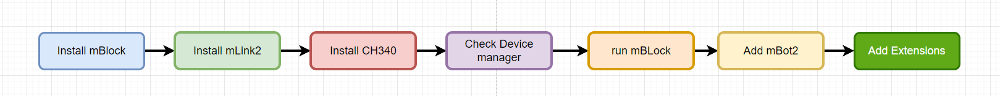
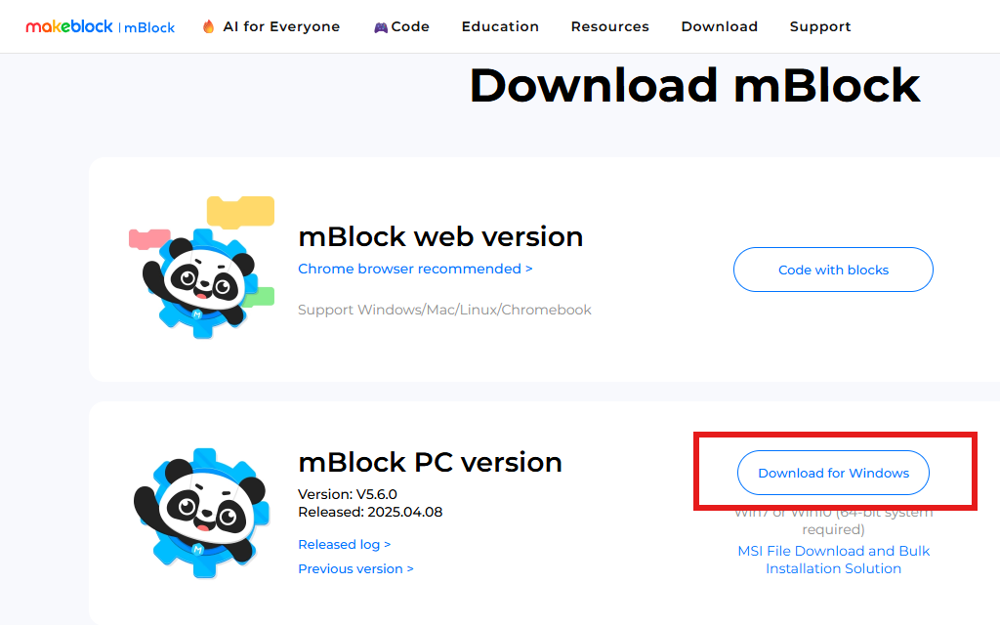
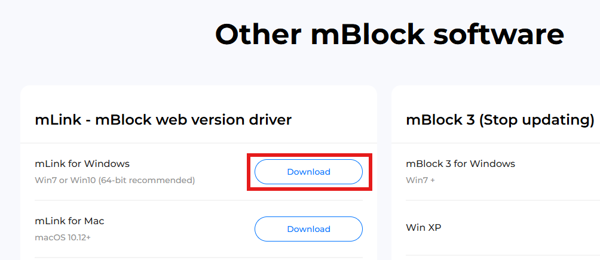
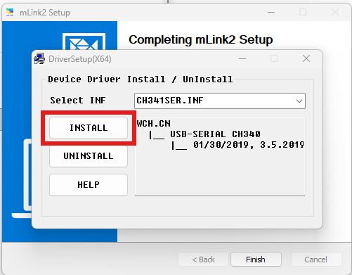
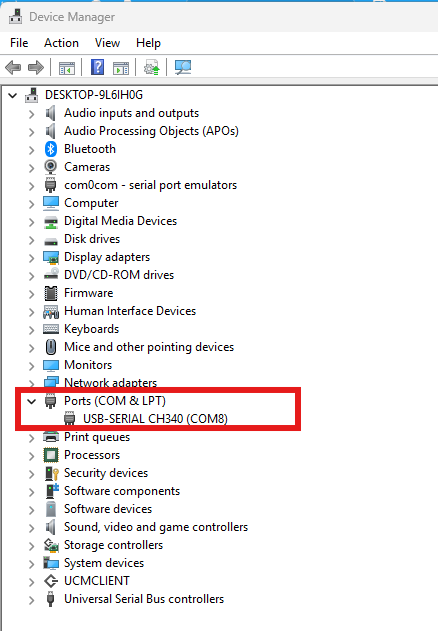
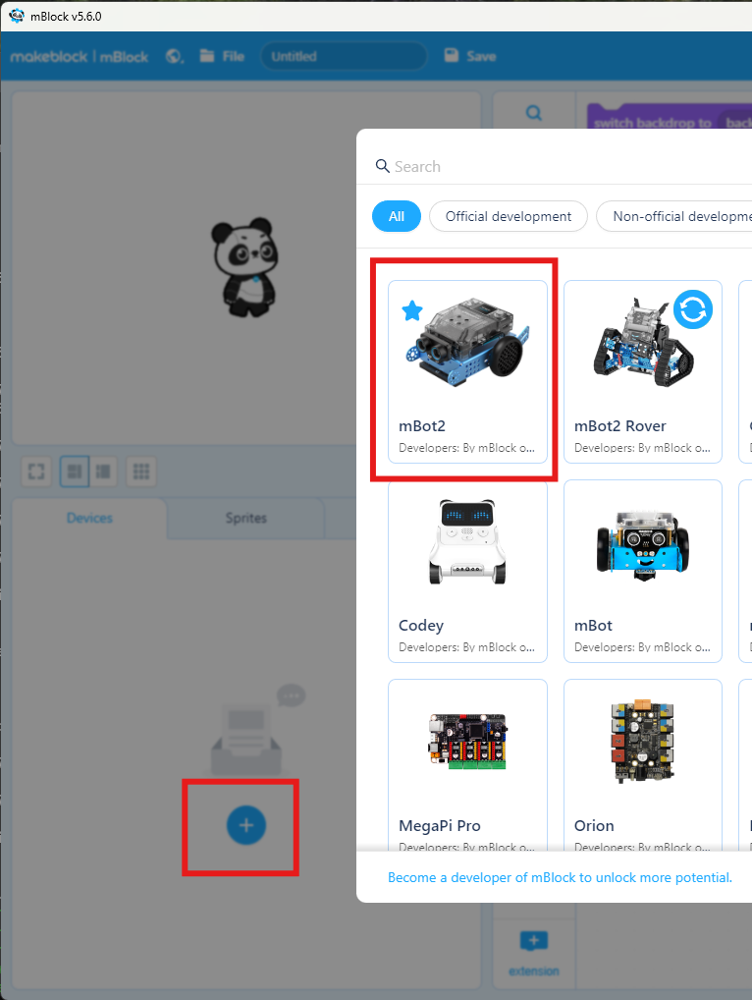
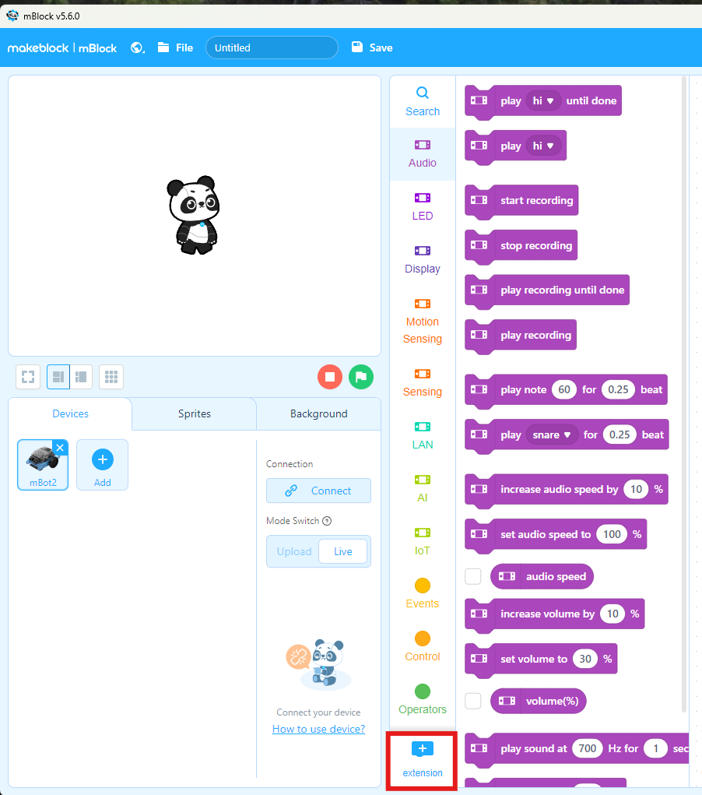
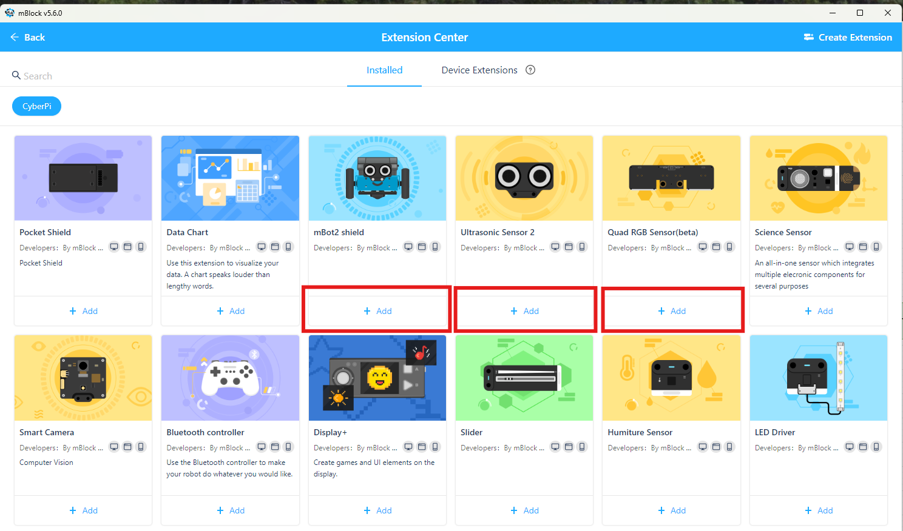
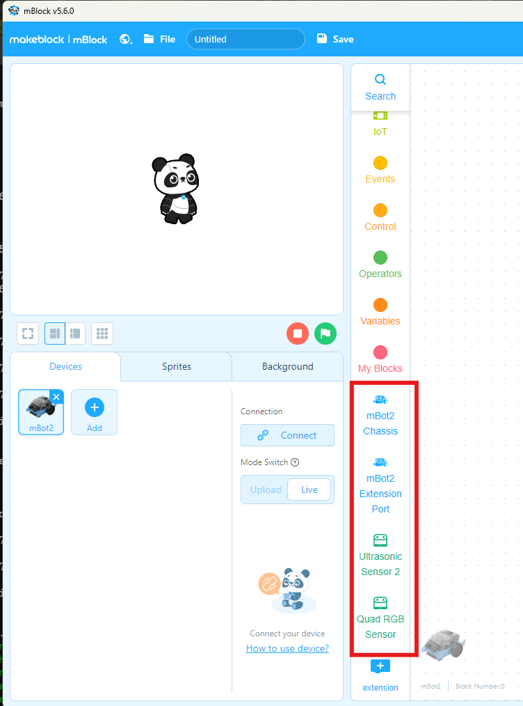

# Robotics with mBot2: AI Vision & Programming

Interactive class demos for a 12-session mBot2 course (sessions 2–11).
Left: mBlock-style block code that highlights the running block. Right: a 3D mBot2 simulation with a compass.

**Live site:** https://benchvue.github.io/mbot2/

## Sessions
Class dates: Sundays, Oct 25, 2026 – Jan 31, 2027.
No class: Thanksgiving (11/29), Christmas (12/27) and Martin Luther King Jr. (1/17) weekends.

| # | Date | Demo | Concepts |
|---|---|---|---|
| 1 | Oct 25 | Build Day | Parts checklist, real-size screw ruler, 11 mBot2 steps + 6 AI Camera 2.0 steps |
| 2 | Nov 1 | Hello, mBot2! | Sequence |
| 3 | Nov 8 | Shape Artist | Repeat loop |
| 4 | Nov 15 | Wall Bounce | Ultrasonic distance, if / else |
| 5 | Nov 22 | Line Follower | Line sensor, steering |
| 6 | Dec 6 | Traffic Light Robot | Color sensor |
| 7 | Dec 13 | AI Color Guard | AI Camera 2.0: learn & find a color |
| 8 | Dec 20 | Ball Chaser | AI Camera 2.0: x-coordinate tracking |
| 9 | Jan 3 | AprilTag Explorer | AI Camera 2.0: tags & navigation |
| 10 | Jan 10 | Follow Me | AI Camera 2.0: posture + ultrasonic |
| 11 | Jan 24 | Robot Train Mission | Combine everything |
| 12 | Jan 31 | Project Day | Idea diagram: mix learned skills into your own robot |

---

## Set up mBlock 5 for mBot2 (Windows)

Do this once on every Windows computer before Session 2. All downloads come from the official page:
**https://mblock.cc/pages/downloads**



### 1. Install mBlock 5 (v5.6.0)
On the download page, find **mBlock PC version — Version: V5.6.0** and click **Download for Windows**.
Run the downloaded `V5.6.0.exe` and follow the installer.

- Requires Windows 7 or Windows 10/11, **64-bit**.
- Use the PC (desktop) version, not the web version, so the class works the same on every computer.



### 2. Install mLink2
Scroll down to **Other mBlock software → mLink - mBlock web version driver** and click **Download** next to
**mLink for Windows**. Run the installer.

mLink lets the browser and mBlock talk to the robot over USB. Install it now so the web version
(https://ide.mblock.cc) also works if a student uses it at home.



### 3. Install the CH340 USB driver
CyberPi connects through a **CH340** USB chip. Windows needs this driver to see the robot.

- mBlock may offer to install the driver the first time you connect. Accept it.
- If not, download **CH341SER.EXE** from the chip maker (WCH), run it, and click **INSTALL**.
- Restart mBlock after installing.



### 4. Check Device Manager
Connect mBot2 (CyberPi) to the computer with the USB-C cable and turn it on.
Open **Device Manager** (right-click the Start button → Device Manager) and expand **Ports (COM & LPT)**.
You should see **USB-SERIAL CH340 (COMx)**. Remember the COM number.

If you see a yellow warning icon or nothing appears: try another USB cable (some cables are charge-only),
try another USB port, or reinstall the CH340 driver.



### 5. Run mBlock
Open **mBlock 5** from the Start menu or the desktop shortcut.

### 6. Add mBot2
In the **Devices** panel (bottom left), click **+ Add**, choose **mBot2**, and click **OK**.
Then click **Connect**, pick the COM port you saw in Device Manager, and click **Connect** again.



### 7. Add extensions
With mBot2 selected, click **+ Extension** at the bottom of the block categories.



Add these **three** extensions. The class demos use all of them:

| Extension | Used in |
|---|---|
| **Quad RGB Sensor** (line and color) | Sessions 5, 6, 11 |
| **Ultrasonic Sensor 2** (distance) | Sessions 4, 10, 11 |
| **AI Camera 2.0** | Sessions 7–10 |



When they are added, their block categories appear on the left. mBlock is ready.



> Tip: a `.mblock` file exported from the demo site (Export → mBlock 5 project) already includes these
> extensions, so opening it in mBlock adds them automatically.

---

## Phones
On narrow screens the 3D view comes first, with a small Run button inside it.
**Hide blocks** gives the robot the whole screen. Turn tips appear as a small bar at the bottom edge.

## Run
Static site, no server needed.
- **Online:** GitHub Pages (below)
- **Offline check:** open `index.html` in Chrome/Edge (internet needed for three.js and fonts)

## Publish with GitHub Pages
1. Push these files to the root of the `main` branch.
2. Repo → **Settings → Pages** → Source: *Deploy from a branch* → Branch: `main`, folder `/ (root)` → Save.
3. After about a minute the site is at `https://benchvue.github.io/mbot2/`.

## Edit the demos
Demo programs live in `tools/demos.py` (block helper functions keep it short):
```bash
cd tools
python build_data.py   # rewrites data/demos.js
```
Commit `data/demos.js` afterwards. Python is only needed for editing, not for hosting.

## Blocks
All demos use the real mBlock 5 blocks (CyberPi, mBot2 chassis, quad RGB sensor, ultrasonic 2, AI Camera 2.0)
with mBlock's wording, colors and device icons. Programs start with **when button A pressed**.
Note: in the encoder-motor block, EM2 is mirrored, so driving forward means EM2 gets a negative RPM.

## Export (toolbar → Export)
- **mBlock 5 project (.mblock)** – opens in mBlock 5 with real blocks (IDs verified from files saved by mBlock 5.6.0).
  Works for all sessions (2–11).
- **mBlock Python (.py)** – for the Python tab in mBlock 5 (AI Camera 2.0 calls are left as helper stubs).
- **Block sheet (.png)** – printable picture of the blocks
- **Program data (.json)**

## Files
```
index.html
css/style.css
data/demos.js          generated demo data
images/                mBlock setup screenshots (README)
js/sim-core.js         worlds, sensors, robot motion (cm, north = -Z)
js/interpreter.js      block runner (variables, My Blocks, parallel scripts)
js/blocks.js           block drawing + yellow highlight
js/scene3d.js          three.js world and mBot2 model
js/export.js           Python / PNG / JSON export
js/mblock.js           .mblock export (zip writer + verified block IDs)
js/mblock-template.js  Stage/Panda/device template from mBlock 5.6.0
js/audio.js            sounds and notes
js/app.js              UI, compass, sensor panel
tools/demos.py         demo source
tools/build_data.py    demos.py -> data/demos.js
```
